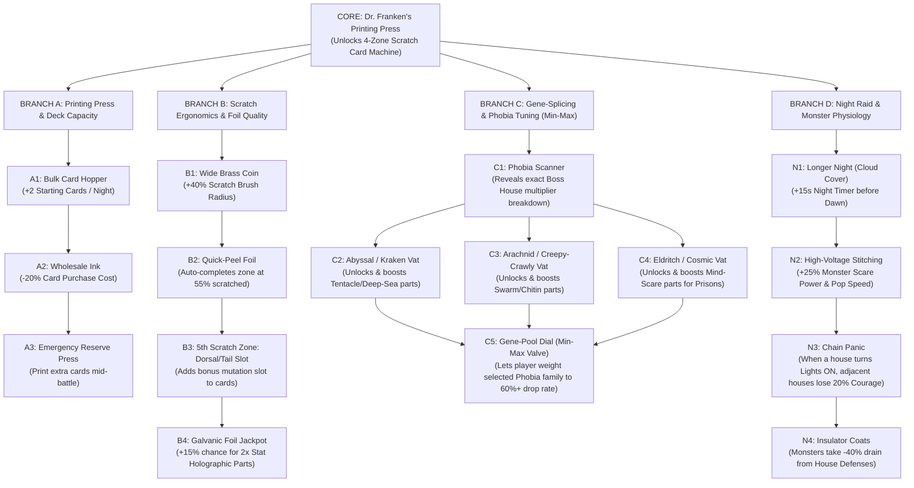

# FrankenScratcher — Game Design & Research Documentation (`GAME_DESIGN.md`)

> **Core Loop Summary**: In **FrankenScratcher**, you play a mad scientist in a nighttime laboratory who built a **Monster Scratch-Card Machine**. In the **Lab**, you upgrade your Tech Tree, tune your monster gene pools to counter the **Central Boss House's phobia**, and buy a deck of 4-zone scratch cards (`Head`, `Torso`, `Legs`, `Hands`). You then launch into the **Night Raid**: a dark, sleeping village cluster with a **Night Timer**. As you scratch off your cards during the raid, stitched monsters assemble on the spot and pop up around the houses—scaring sleeping residents until their **lights turn ON**!

---

## 1. Research: Comparing 3 Working Examples Per Pillar

Following our development rules, we evaluated **three proven working games** for each of FrankenScratcher's three core pillars and selected the best model for our mobile-first design.

### Pillar A: Scratch Card & Unit-Spawning Tactile Loop
| Example Game | How It Works | Pros | Cons for FrankenScratcher |
| :--- | :--- | :--- | :--- |
| **1. *Booster Pack Heroes*** | Rip open booster packs during wave combat; pulled cards immediately spawn heroes/attacks on the battlefield. | Immediate link between opening cards and battlefield impact; huge foil/rarity excitement. | Ripping a single top seam is less granular than scratching 4 distinct body-part slots (`Head`, `Torso`, `Legs`, `Hands`). |
| **2. *Scratch Inc.*** | Pure lottery scratch-off incremental; swipe across silver foil panels to reveal symbols; upgrade brush size and ticket tiers. | Extremely satisfying mobile swipe feel; clear visual progress as foil clears; easy to add extra scratch zones. | Scratching only gives flat numbers/cash rather than assembling living stitched monsters. |
| **3. *Luck be a Landlord*** | One-button spin that instantly populates symbols on a grid with synergies. | Fast synergy calculation. | Lacks tactile scratching; feels like a slot machine rather than a physical scratch card. |

- **BEST PICK (Winner)**: **Hybrid of *Scratch Inc.* + *Booster Pack Heroes***.
  - **Why**: We take *Scratch Inc.*'s tactile silver-foil swipe mechanic divided into **4 anatomical scratch zones** (`Head`, `Torso`, `Legs`, `Hands`) on each card, and combine it with *Booster Pack Heroes*' instant battlefield payoff: the moment a card's zones are scratched in battle, the parts stitch together in a lightning flash and the monster pops onto the village map to scare houses!

---

### Pillar B: Scaring Houses, "Lights ON" Feedback & Boss Phobias
| Example Game | How It Works | Pros | Cons for FrankenScratcher |
| :--- | :--- | :--- | :--- |
| **1. *Haunt the House: Terrortown*** | Nighttime 2D/cluster town where buildings start quiet and dark; as monsters/ghosts scare occupants, windows light up, silhouettes panic, and terror meters fill. | Instant visual clarity on mobile: **Dark Window = Sleeping**, **Lit Yellow/Orange Window + Shaking Roof = Scared!** | Manual room-by-room ghost movement is too slow for an incremental card-scratcher. |
| **2. *Ghost Master*** | Every mortal and household has specific psychological **Phobias** (e.g., *Thalassophobia / Ocean*, *Arachnophobia*, *Anatomy / Gore*). Matching monster traits to a target's phobia deals massive multiplier fear. | Creates the exact **Lab Min-Max Puzzle** we want for the **Central Boss House** (e.g., Sailor family terrified of Kraken parts). | Complex 3D camera and slow RTS micromanagement don't fit mobile portrait/landscape thumb play. |
| **3. *Plants vs. Zombies*** | Rigid 5-lane horizontal grid where units march left-to-right. | Simple collision math. | Doesn't feel like a clustered sleeping village surrounding a central Boss House. |

- **BEST PICK (Winner)**: ***Haunt the House* Visual Cluster ("Lights ON = Scared") + *Ghost Master* Phobia Min-Maxing**.
  - **Why**: A radial/clustered nighttime village with a prominent **Central Boss House** gives immediate visual satisfaction as dark houses light up one by one around the village, while *Ghost Master*'s phobia tags make Lab preparation meaningful.

---

### Pillar C: Lab Tech Tree & Timed Run Pacing
| Example Game | How It Works | Pros | Cons for FrankenScratcher |
| :--- | :--- | :--- | :--- |
| **1. *Nodebuster* / *Digseum*** | Short, punchy timed active runs (30–90 seconds) harvesting resources $\rightarrow$ return to a visual branching **Lab Tech Tree** where every node visibly upgrades the next run. | Perfect mobile session length; zero dead time; Night Timer feels exciting rather than punishing because every night funds new Tech Tree nodes. | Pure stat nodes alone don't let you customize *which* monster types print for a specific Boss House. |
| **2. *NecroMerger*** | Drag-and-merge monster body parts on a grid inside a lair. | Great mad-scientist monster theme. | Grid inventory clutter slows down fast card-scratching action. |
| **3. *Cookie Clicker*** | Endless scrolling list of passive `+5%` upgrades while numbers go up passively. | Classic idle scaling. | Lacks a distinct Lab Phase vs. Night Raid Phase loop and lacks tactical Boss House targeting. |

- **BEST PICK (Winner)**: ***Nodebuster*-style Timed Night Run $\leftrightarrow$ Visual Branching Lab Tech Tree**, enhanced with **Toggleable Gene-Pool Valves**.
  - **Why**: The Night Timer creates urgency during the village raid, and returning to the Lab lets the player both buy permanent upgrades AND toggle/weight which monster traits (e.g., *Kraken/Abyssal*, *Gothic/Undead*, *Cyber/Galvanic*, *Beast/Feral*) their Scratch-Card Machine prints to exploit the Boss House's phobia!

---

### Pillar D: Quest-Driven Prestige & "Angry Villager Mob" Reset
| Example Game | How It Works | Pros | Cons for FrankenScratcher |
| :--- | :--- | :--- | :--- |
| **1. *NecroMerger* (Thematic Reset Cutscene + Meta-Shop)** | Reaching key milestones triggers a dramatic comedic reset where your lair is wiped out, unlocking permanent meta-upgrades and new machine tiers. | Strong cartoon narrative justification for why your lab resets; feels like a story milestone rather than a dry math reset. | Requires long grind if not paired with clear short-term quests. |
| **2. *Egg, Inc.* / *Tap Titans* (Passive Formula Prestige)** | Prestige currency Trickles in solely based on total lifetime cash earned (`sqrt(cash)`). | Simple math. | Less structured than completing tangible visual quests/bounties before the mob arrives. |
| **3. *Scratch Inc.* / *Melvor* (Quest/Task Stamps $\rightarrow$ Tier Expansion)** | Completing specific objective stamps rewards a rare meta-currency and expands the upgrade tree with massive game-changing nodes. | Gives the player clear, bite-sized visual goals (`💡 Scare 15 Houses`, `👑 Scare Boss`, `🐙 Stitch 3 Krakens`). | Needs a funny thematic trigger when prestige activates. |

- **BEST PICK (Winner)**: **Hybrid of *Scratch Inc.* Visual Quest Stamps + *NecroMerger* "Angry Cartoon Mob Raid" Cutscene**.
  - **Why**:
    1. Players complete visual, icon-only **Infamy Quests** (e.g., `🏠💡 x10`, `⚓👑💡`, `🐙 x3`) to earn **🔥 Mob Torches (Prestige Currency)**.
    2. Triggering Prestige plays a hilarious 3-second **Cartoon Villager Raid (`🧑‍🌾🔥🔱`)**: villagers storm the Lab with pitchforks and torches, smashing the Scratch-Card Machine!
    3. When you return to the Lab, **the Tech Tree expands outward**, revealing **🔥 Fireproof Prestige Nodes** that spend **Mob Torches (`🔥`)** for massive permanent multipliers (`x3 Scare Power`, `+2 Extra Card Zones`, `Auto-Scratch Laser`, new Monster Vats, and harder Biomes).

---

## 2. Core Gameplay Loop Specification

```mermaid
flowchart LR
    A["1. THE LAB<br/>Read Boss House Story & Phobia"] --> B["2. TECH TREE & TUNING<br/>Upgrade Machine & Bias Monster Parts"]
    B --> C["3. PRINT DECK<br/>Buy Scratch Cards for the Night"]
    C --> D["4. NIGHT RAID (Village)<br/>Night Timer Starts; All Houses Dark"]
    D --> E["5. SCRATCH CARDS<br/>Scratch 4 Zones: Head, Torso, Legs, Hands"]
    E --> F["6. MONSTER POPS UP<br/>Stitched Monster Scares Nearby Houses"]
    F --> G["7. LIGHTS TURN ON!<br/>Scared Houses Drop Scream Essence & Fear Coins"]
    G --> H{"Boss House Scared<br/>or Dawn Reached?"}
    H -- "Dawn / Out of Cards" --> A
    H -- "Complete Visual Quests (🔥)" --> J["8. ANGRY MOB RAID! 🧑‍🌾🔥🔱<br/>Villagers Burn Lab & Machine"]
    J --> K["9. EXPANDED PRESTIGE TREE<br/>Spend 🔥 Torches on Massive Permanent Upgrades!"]
    K --> A
```

### Phase 1: The Lab (Preparation Phase — Icon-First, Minimal Text!)
> **UX Golden Rule — Show, Don't Tell**: Avoid walls of text or long tooltips! Every mechanic, Boss phobia, and Tech Tree node must communicate visually with **icons, silhouettes, thought bubbles, and at most 2–4 words**.

1. **The Scratch-Card Machine**:
   - Centerpiece contraption in Dr. Franken's Lab.
   - Prints silver-foiled **Monster Scratch Cards**.
   - **Buy Cards**: Big tactile `[+1 Card 🪙]` button and a visual stack of cards ready for the night, plus a big green `[NIGHT RAID 🌙 ▶]` button.
2. **The Boss House Clue (Visual Thought Bubble — No Text Walls!)**:
   - Instead of long story paragraphs, the Boss House preview shows a **visual portrait + phobia bubble**:
     - *Example 1 (Harbor Village)*: Shows a **Sailor Hat House** with a thought bubble: `😱 🐙 x3` (*Scared of Kraken/Tentacles!*).
     - *Example 2 (Suburb Manor)*: Shows a **Fancy Manor** with a thought bubble: `😱 🕷️ x3` (*Scared of Bugs/Spiders!*).
     - *Example 3 (Prison)*: Shows a **Guard Tower Prison** with a thought bubble: `😱 👁️ x3` (*Scared of Cosmic/Eye Monsters!*).
3. **Monster Card Anatomy (4 Visual Silhouette Scratch Zones)**:
   - Every card has **4 foil zones** with clear body-part silhouettes etched on the foil (no text labels needed):
     1. **🙂 HEAD Zone (Top)**: Sets the monster's **Scare Type / Phobia Icon** (`🐙`, `🐺`, `🕷️`, `👁️`).
     2. **👕 TORSO Zone (Center)**: Sets **Heart / Stamina** (`❤️` how long it stays on map).
     3. **🖐️ HANDS Zone (Left/Right)**: Sets **Scare Power** (`💥` how hard it rattles windows).
     4. **🦵 LEGS Zone (Bottom)**: Sets **Speed** (`⚡` how fast it hops between houses).
   - *Later Tech Tree Upgrade* adds a **5th Bonus Zone (`⭐`)**.

---

### Phase 2: The Night Raid (Village Phase)
1. **The Sleeping Village Layout**:
   - Nighttime atmosphere: deep indigo sky, moon/clock showing the **Night Timer** (e.g., `12:00 AM` $\rightarrow$ `6:00 AM Dawn`, starting at `45 seconds` real-time).
   - **Outer Ring of Houses**: 6 to 10 smaller homes (starting with *Houses with Kids* — low Courage/Strength, easy to scare).
   - **Centerpiece — The Boss House**: Larger, distinct architecture in the center of the cluster with a high Courage bar and story badge.
2. **Scratching in Battle**:
   - The bottom portion of the mobile screen (the ergonomic **Thumb Scratch Zone**) holds your current **Scratch Card** from your purchased stack.
   - Swiping your finger/mouse across the 4 foil zones scratches off the metallic coating to reveal the 4 monster parts underneath.
   - Once all 4 zones are revealed (or reach the `75%` clear threshold), **ZAP!** The 4 parts stitch together into a composite monster that launches onto the village!
3. **Scaring Houses & "Lights ON" State**:
   - Active monsters hop/pop up next to dark houses and perform scare animations (rattling shutters, roaring at windows, waving tentacles).
   - Each house has a **Courage / Sleep Meter** (Strength of the people inside):
     - **Lights OFF (Dark Windows + "Zzz" particles)**: Residents are asleep or holding out.
     - **Flickering Lights**: Residents are waking up in panic (`< 50%` Courage left).
     - **LIGHTS ON! (Bright Yellow/Warm Lit Windows + "AAAH!" Scream Pop + Shaking Roof)**: The house is **SCARED**!
   - When a house's lights turn ON:
     - It bursts with **Scream Essence** (used for the Lab Tech Tree) and **Fear Coins** (used to buy more cards & in-run boosts).
     - Scaring outer houses reduces the **Neighborhood Calm Aura** protecting the Central Boss House!
4. **Future Escalation — House Defenses & Harder Biomes** *(Modular & Toggleable)*:
   - **House Defenses**: Guard dogs, porch motion-lights (drain monster stamina), neighborhood watch patrols, ward totems.
   - **Harder Biomes**: Moving from *Suburban Kids' Houses* $\rightarrow$ *Sailor Docks* $\rightarrow$ *Gated Manors* $\rightarrow$ *High-Security Prisons* with tough criminals requiring multi-part phobia synergies and upgraded 5–6 slot cards.

---

## 3. Upgradable Lab Tech Tree Specification

The Lab Tech Tree is divided into **4 Core Branches** covering production, card anatomy, phobia min-maxing, and night raid dominance. Every node has a clear level cap, cost in **Scream Essence**, and immediate gameplay impact.

### Detailed Tech Tree Nodes Table

| Node ID | Name | Branch | Max Lvl | Effect per Level | Purpose in Loop |
| :--- | :--- | :--- | :--- | :--- | :--- |
| **`CORE_0`** | **Monster Card Press** | Core | `1` | Prints 4-zone cards (`Head`, `Torso`, `Legs`, `Hands`). | Base game starter. |
| **`A1`** | **Bulk Card Hopper** | A: Press | `5` | `+1` free base Scratch Card at the start of every Night (`3` $\rightarrow$ `8`). | Ensures player always has cards to scratch. |
| **`A2`** | **Wholesale Cardstock** | A: Press | `5` | Reduces cost of buying extra cards in the Lab by `-12%` per level. | Lets player stockpile big decks for tough nights. |
| **`A3`** | **Full-Card Single Swipe** | A: Press | `3` | Scratching across zone borders flows smoothly with zero drag penalty. | Mobile thumb comfort. |
| **`B1`** | **Heavy Brass Scratcher** | B: Scratch | `5` | Increases scratch brush radius by `+25%` per level. | Makes scratching faster and more satisfying. |
| **`B2`** | **Quick-Snap Foil** | B: Scratch | `3` | Lowers the reveal threshold per zone from `75%` $\rightarrow$ `60%` $\rightarrow$ `45%` $\rightarrow$ `30%`. | Speeds up monster spawning under Night Timer pressure. |
| **`B3`** | **5th Zone: Mutation Stamp** | B: Scratch | `1` | Adds a **5th scratch spot** on cards that grants a special modifier (e.g., *Twin Heads*, *Giant Size*, *Shockwave*). | Major mid-game card anatomy upgrade. |
| **`B4`** | **Holographic Foil Coating** | B: Scratch | `5` | `+6%` chance per zone to pull a **Golden/Holo Part** (`2.5x` Scare Power). | Classic booster/scratcher dopamine hit. |
| **`C1`** | **Phobia Dossier Lens** | C: Phobia | `1` | Displays exact Boss House phobia weaknesses & resistance percentages in the Lab. | Enables informed min-maxing. |
| **`C2`** | **Kraken / Abyssal Culture** | C: Phobia | `3` | Unlocks **Kraken Head, Tentacle Arms, Barnacle Torso, Crab Legs** (`3x` vs. Sailor Boss). | Counter for Stage 1 Boss House (*The Sailor Family*). |
| **`C3`** | **Creepy-Crawly Culture** | C: Phobia | `3` | Unlocks **Mantis Head, Chitin Torso, Spider Legs, Pincer Hands** (`3x` vs. Manor Boss). | Counter for Stage 2 Boss House. |
| **`C4`** | **Eldritch / Nightmare Vat** | C: Phobia | `3` | Unlocks **Void Eye Head, Ribcage Portal, Shadow Tendrils** (`3x` vs. Prison Boss). | Counter for late-game hardened criminals. |
| **`C5`** | **Gene-Bias Dial (Min-Max)** | C: Phobia | `3` | Allows toggling **Preferred Gene Family** in the Lab to boost its print odds by `+20%` per level. | Core strategic min-max tool in the Lab! |
| **`D1`** | **Eclipse Generator** | D: Night | `5` | Extends the **Night Timer** by `+8 seconds` per level. | Gives more time to scare the Boss House. |
| **`D2`** | **Galvanic Nerves** | D: Night | `5` | Stitched monsters pop up and attack houses `+15%` faster per level. | Increases DPS against high-strength houses. |
| **`D3`** | **Contagious Screams** | D: Night | `3` | Whenever a house's **Lights Turn ON**, it sends a shockwave dealing `15%/30%/45%` scare damage to neighboring houses. | Satisfying chain-reaction village clearing. |
| **`D4`** | **Full-Body Synergy Bonus** | D: Night | `3` | If 2, 3, or all 4 parts on a card share the same Phobia Set (e.g., *Full Kraken*), monster gains `+50% / +125% / +300%` Scare Power! | Rewards Lab gene-pool min-maxing! |

---

## 4. Prestige System: "The Angry Villager Mob Raid" (`🧑‍🌾🔥🔱`)

### Step 1: Visual Infamy Quests (Earn `🔥` Mob Torches)
Instead of long text descriptions, the Lab displays **3 Visual Quest Stamps** at a time. Completing each stamp awards **🔥 Mob Torches (Prestige Currency)**:
- `🏠💡 x10` $\rightarrow$ **`+1 🔥`** *(Turn lights ON in 10 houses)*
- `🐙⚡ x3` $\rightarrow$ **`+1 🔥`** *(Spawn 3 Full-Synergy monsters)*
- `👑🏠💡` $\rightarrow$ **`+3 🔥`** *(Turn lights ON in the Central Boss House)*
- `⏱️⚡ <20s` $\rightarrow$ **`+2 🔥`** *(Scare 5 houses in under 20 seconds)*

### Step 2: The Cartoon Mob Raid (`🧑‍🌾🔥🔱`)
- Once you have collected at least **`3 🔥`**, the **[🔥 PROVOKE MOB RAID]** lever unlocks in the Lab (or triggers automatically when the Boss House is conquered and you advance).
- **Cartoon Cutscene (2.5s, Zero Text)**:
  - Silhouettes of angry villagers waving **torches (`🔥`) and pitchforks (`🔱`)** charge into the Lab!
  - They smash the Scratch-Card Machine (`💥⚙️`), resetting standard **Coins (`🪙`)**, **Scream Essence (`👻`)**, and basic **Tier-1 Tech Nodes**.
  - You keep all **🔥 Mob Torches** and all **Permanent Prestige Nodes**!

### Step 3: Expanded Prestige Tech Tree (`🔥` Outer Ring)
When you return to the rebuilt Lab after the mob raid, the **Tech Tree zooms out**, revealing a glowing **Outer Ring of Fireproof Prestige Upgrades** bought with **`🔥` Mob Torches**:

| Prestige ID | Visual Label (Max 3 Words) | Cost (`🔥`) | Massive Permanent Effect |
| :--- | :--- | :--- | :--- |
| **`P1`** | **`🔥` Fireproof Vault** | `1 🔥` | Start every prestige with **6 Cards** and **`x2` Scream Essence (`👻`)** permanently! |
| **`P2`** | **`⚡` Tesla Auto-Scratcher** | `2 🔥` | Unlocks a toggleable **Auto-Scratch Laser** that scratches cards automatically in battle! |
| **`P3`** | **`🧬` Twin-Monster Press** | `3 🔥` | Every scratched card has a **`50%` chance (`100%` at Lvl 2)** to pop out **TWO monsters at once**! |
| **`P4`** | **`🃏` 6-Zone Mega Card** | `4 🔥` | Upgrades Card Anatomy to **6 Scratch Zones** (adds **Twin-Head** & **Aura** slots)! |
| **`P5`** | **`🏰` Unlock Next Village** | `3 🔥` | Unlocks harder stages: **Gated Manor** $\rightarrow$ **Military Barracks** $\rightarrow$ **High-Security Prison** (`x5` rewards)! |
| **`P6`** | **`🔒` Blueprint Memory** | `5 🔥` | Basic Tech Tree Branch C (**Phobia Vats & Gene Dial**) **never resets** on future Mob Raids! |

---

## 5. *Booster Pack Heroes* Pixel-Art Style & Standalone Assets

### Visual Direction (16-Bit Pixel Art)
- **Inspired by *Booster Pack Heroes***: Crisp retro 16-bit pixel art (`image-rendering: pixelated`), chunky pixel outlines, retro card frames, and tactile foil sheen.
- **Village Map Layout**:
  - **Background**: Simple, clean **dark green pixel-art grass clearing** framed by **pixelated pine trees around the periphery (edges)** so the center playfield is high-contrast and never visually cluttered.
  - **Standalone Pixel House Assets**: Each house is its own standalone pixel-art sprite (not baked into the background).
    - **Sleeping State**: Dark pixel windows + floating `💤`.
    - **Scared State (`Lights ON`)**: Swaps to bright warm yellow pixel windows (`💡`), shakes/bounces, and pops `👻` Scream Essence.
- **Pixel Monster Part Frames & Code Puppet Animation**:
  - Each Monster Set has 4 standalone pixel-art part sprites (`Head`, `Torso`, `Hands`, `Legs`).
  - When a card is scratched, the stitched pixel monster **pops up from under a house's window**, raises its **Hands near its ears (`🙌`)**, and **wiggles its Head and Hands side-to-side** until the house lights turn ON!

---

## 6. Starting Title Screen, Interactive Tutorial & Minimal Text

### Starting Screen (`hud.start_screen`)
- **`[🎓 PLAY + TUTORIAL]`** — Starts with a step-by-step visual hand pointer (`👆`) and 2-word prompts.
- **`[▶ PLAY (NO TUTORIAL)]`** — Jumps straight into the Lab with all HUD unlocked.
- **`[⚙️ OPTIONS]`** — Sound/SFX toggle, Haptics toggle, Auto-Tuck speed, Export/Import Save, Hard Reset.
- **`[📜 CREDITS]`** — Clean retro pixel credits box.

### Step-by-Step Visual Tutorial (Zero Confusion, Max 3 Words per Prompt)
1. **Step 1 (Lab)**: Bouncing `👆` points at the **Monster Machine** $\rightarrow$ `"1. Print Card 🃏"`
2. **Step 2 (Lab)**: Bouncing `👆` points at **`[🌙 RAID ▶]`** $\rightarrow$ `"2. Go to Village 🌙"`
3. **Step 3 (Village)**: Bouncing `👆` points at the **Bottom Card** $\rightarrow$ `"3. Tap Card 👆"`
4. **Step 4 (Scratch)**: Animated `👆` swipes across the **4 Silver Foil Zones** $\rightarrow$ `"4. Scratch 4 Spots! 🪙"`
5. **Step 5 (Watch!)**: Card tucks down; stitched monster pops under a house window and turns **Lights ON (`💡`)** $\rightarrow$ `"Lights ON = Scared! 🎉"`

---

## 7. Customizable Lab Machines & Unlockable Monster Collection

### Customizable Lab Machine Slots (`hud.lab_machines`)
The Lab features **3 Customizable Machine Slots** where players can install, upgrade, and tune different card-printing machines:
1. **Machine #1 — Monster Part Printer (Starter)**:
   - Prints **4-Zone Monster Scratch Cards** (`Head`, `Torso`, `Hands`, `Legs`).
   - Player can select which unlocked Monster Set to bias (`🧟 Franken`, `🐙 Kraken`, `🎃 Pumpkin`, `🧛 Vampyr`).
2. **Machine #2 — Atmosphere Card Printer (Unlockable)**:
   - Prints **Atmosphere / Weather Scratch Cards** (`🌧️ Thunder Storm`, `🌫️ Spooky Fog`, `🌕 Blood Moon`).
   - Scratching an Atmosphere Card during the Night Raid changes the village weather and grants a global raid bonus (`+50% Scare Power`, `+12s Night Timer`, or `2x Scream Essence`).
3. **Machine #3 — Spooky Prop Printer (Unlockable)**:
   - Prints **Haunted Yard Props** (`🎃 Scarecrow`, `🕯️ Poltergeist Lantern`) that deploy next to houses and passively drain their courage all night.

### Unlockable Monster Sets & Full-Pack Collection Bonus (`hud.monster_album`)
- Players unlock new **Monster Sets** (`🧟 Franken Golem`, `🐙 Deep Kraken`, `🎃 Pumpkin Fiend`, `🧛 Night Vampyr`).
- Scratching off parts discovers `Head`, `Torso`, `Hands`, and `Legs` in the **Monster Pack Album (`0/4` $\rightarrow$ `4/4`)**.
- **Complete Pack Bonus (`4/4 Collected`)**:
  - Completing all 4 parts of a Monster Set permanently unlocks its **Full Pack Mastery Bonus** (`+50% Scare Power` for that set + global `👻` boost)!
  - Scratching a card where all 4 parts match a completed set spawns an **Awakened Super-Scary Monster** (larger scale, glowing pixel aura, `2.5x` Scare Damage)!

### Screen Architecture (`9:16` Portrait Primary)
- **Full-Screen Stage (`100%` Height)**:
  - The **Lab Room** (during preparation) or the **Sleeping Night Village** (during the raid) fills the entire vertical screen so you have a rich, unobstructed view of all the houses and monsters popping up under windows.
- **Interactive Bottom Card Hand (4-State Flow)**:
  1. **`TUCKED` (Watching Mode — Default)**:
     - Your stack/fan of purchased Scratch Cards sits **tucked down at the very bottom edge** (mostly hidden below the bottom border, peeking up just enough to tap).
     - Gives you `90%+` clear view of the village to watch your monsters pop up, wiggle their hands by their ears, and turn house lights ON!
  2. **`RAISED` (Card Selection Fan)**:
     - **Tap the tucked cards at the bottom** $\rightarrow$ the card hand smoothly slides up so you can see your available cards.
  3. **`FOCUSED_SCRATCH` (Enlarged Active Scratch Card)**:
     - **Tap/choose a card** $\rightarrow$ that card **scales up big in the foreground** (showing its 4 silver-foil scratch zones: `Head`, `Torso`, `Hands`, `Legs`), while the other cards tuck away.
     - You scratch the 4 zones comfortably with your finger.
  4. **`STITCH_AND_HIDE` (Auto-Tuck & Monster Spawn)**:
     - **Finish scratching all 4 zones** $\rightarrow$ the remaining cards **automatically shrink/hide back under the bottom edge**, the 4 revealed parts (`Head + Torso + Hands + Legs`) stitch together in a lightning flash, and the stitched monster leaps into the village to pop up under windows and scare the houses while you watch!

